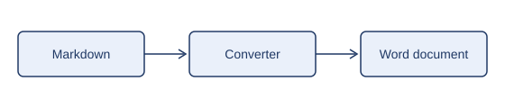

# Sample document

> This note sits right after the title. It can be dropped from the Word document
> with the `drop_note_after_title` option.

## Document control

<!-- colwidths: 30 70 -->

| Field      | Value  |
|------------|--------|
| Status     | Draft  |
| Version    | 0.1    |
| Page count | [Auto] |

## 1. Introduction

This sample shows what the converter understands. It is written like any Markdown
page: the layout markers are HTML comments, invisible when the page is rendered.

The heading above is numbered by hand in the source. The host template numbers
headings itself, so the configuration removes the manual numbers
(`strip_heading_numbers`).

### 1.1 Text

A paragraph with *italic*, **bold** and `inline code`. A link such as
[the other example](../multi/01-context.md) is replaced by its text when
`flatten_links` is set.

- a bullet list item
- another one

1. a numbered item
2. another one

### 1.2 Figure



*Figure: from Markdown to a Word document.*

## 2. Tables and code

<!-- colwidths: 20 55 25 -->

| Marker                         | Effect                                                   | Scope                         |
|--------------------------------|----------------------------------------------------------|-------------------------------|
| `<!-- pagebreak -->`           | Starts a new page                                        | Anywhere between two blocks   |
| `<!-- colwidths: 20 55 25 -->` | Sets the column widths of the next table, as proportions | The table that follows        |
| `<!-- internal:start -->`      | Opens a block left out of the Word document              | Up to `<!-- internal:end -->` |

*Table: the layout markers.*

A code block uses the style named `Code` of the host template:

```json
{
  "source": "sample.md",
  "host": "../host-template.docx"
}
```

<!-- pagebreak -->

## 3. A new page

This chapter would start on a new page anyway, because it is a first-level
chapter of the Word document. The marker above shows the syntax.

<!-- internal:start -->

## Notes for the authors

This section stays in the Markdown source and is left out of the Word document.

<!-- internal:end -->
